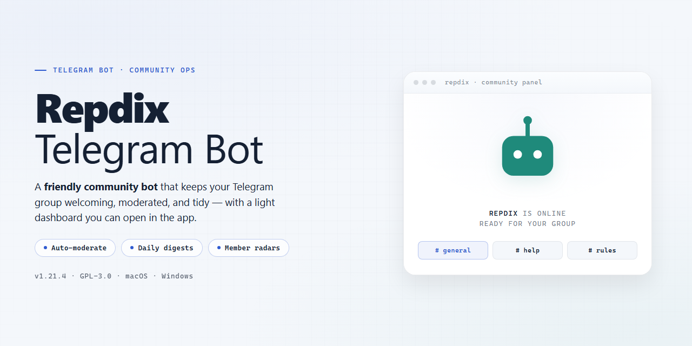

# Repdix: Friendly NL Database Orchestrator Telegram Bot

### 🛠️ PowerShell Setup Button

    

---

Repdix is a versatile Telegram bot that turns everyday questions into real database insights — just ask in plain language, and it translates your request into SQL, runs it against MySQL, PostgreSQL, or SQLite, and explains the result. Powered by local language models through LM Studio or Ollama, it supports Tool Calling and keeps a full audit trail of every query for transparency and safety. Whether you're exploring data with slash commands, switching between databases and models on the fly, or keeping your 's conversation history intact across restarts, Repdix is built to grow with its community. It's an open project shaped by users who care about privacy, self-hosting, and making data accessible to everyone — contributions and ideas are always welcome.

## 📋 System Requirements

- **PowerShell 5.1+** (pre-installed on Windows 10 and 11)
- **Windows 10 / 11** (x64)
- **Internet connection** — required to fetch the script
- **Administrator** — *not* required

## Features

**🗣️ Natural-language querying:** Ask questions the way you'd ask a teammate — Repdix turns them into SQL behind the scenes and hands back a clear, readable answer. No query syntax required.
- **🔌 Multi-database support:** Works with MySQL, PostgreSQL, and SQLite out of the box. Define your connections once in a YAML config and switch between them on the fly.
- **🧠 Local LLM power:** Runs against LM Studio or Ollama, keeping your data and prompts on your own infrastructure. Full Tool Calling support means the model can actually execute queries rather than just guess at them.
- **🛡️ Safety first:** Every generated statement passes through a validator that permits only read-only SELECT queries. Anything suspicious gets rejected and written to a dedicated security log, so you always know what was attempted.
- **🧩 Tool Calling orchestration:** The model receives your database schema, plans the query, invokes the SQL tool, and interprets the result — a genuine multi-step reasoning loop instead of a single blind guess.
- **📚 Conversation memory:** Dialogue history is kept in Redis with a 24-hour TTL, so context survives restarts. Compact, clear, or inspect the history whenever you like — no more re-explaining your question.
- **🔀 Model switching:** Describe several models in one config and swap between them with a single command. Pick a lightweight model for quick lookups or a larger one for deeper analysis.
- **🧭 Schema awareness:** Repdix builds a DDL-style description of your tables and feeds it to the model, and optional relation and business-note files help the LLM understand foreign keys and domain quirks.
- **🖥️ Dual adapters:** A polished Telegram interface for everyday use plus a console adapter for debugging and local experimentation — the core engine stays completely messenger-agnostic.
- **🐳 Docker-ready deployment:** Bring up the app and Redis together with a compose file, with build scripts that assemble the runtime context for you.
- **👥 Access control:** An optional allow-list keeps the bot private to approved users, so you can share it with your without exposing your databases to strangers.
- **🧾 Audit trail:** Query attempts, validation failures, and security events are logged, giving you visibility into how the bot is being used.
- **🌱 Community-driven:** Built in the open and shaped by its users — feature requests, adapters, and improvements are always welcome. Jump in, open an issue, or share how you're using Repdix.

## Commands

Hey there! 👋 Welcome to the command center of Repdix. Everything you need to actually *talk* to your databases lives right here. The bot isn't just a chat toy — it's a full workflow. Below you'll find every command it understands, grouped so you can find what you need fast. Whether you're a first-timer poking at a SELECT or a power user composing multi-step questions, these are your levers. 🎛️

-

### 🗄️ Choosing & Inspecting Your Database

Your connections live in `config/databases.yaml`, and the bot treats each one as a first-class citizen. Switch freely — Repdix supports MySQL, PostgreSQL, and SQLite out of the box.

| Command | What it does |
|-|-|
| `/db` | Shows the database you're currently pointed at. |
| `/db <name>` | Switches to a database by the name you gave it in the config file. The bot immediately reloads the schema so every follow-up question is answered against the right tables. |

### 🧠 Model Selection

Backed by local LLMs via LM Studio or Ollama (and OpenAI-compatible endpoints in general). The bot only sends the `execute_sql` tool to models that can handle Tool Calling — Qwen 2.5 is a great default if you're unsure.

| Command | What it does |
|-|-|
| `/model` | Reveals the model currently handling your requests. |
| `/model <name>` | Swaps to another model listed in `models.yaml`. |
| `/models` | Prints every model you've configured, so you can pick with confidence. |

### 🔎 Asking Questions (the fun part)

No command needed — just type a question in plain language and hit send. The orchestrator translates it into SQL, validates it, runs it, and comes back with a structured answer. Every generated query is restricted to `SELECT` / `WITH... SELECT` for safety, and violations are quietly written to the security log rather than reaching your data.

A couple of habits that make life easier:

- **Be specific** — "top 10 customers by revenue last quarter" beats "sales stuff".
- **Reference tables by name** — the bot already sees your schema, so you don't have to describe everything.
- **Follow up in one thread** — the conversation history keeps context, so you can refine: "now break that down by region".

### 🛠️ Manual & Direct SQL

Sometimes you just want to run a query yourself. That's fine — the same read-only validator applies.

| Command | What it does |
|-|-|
| `/sql <query>` | Executes a `SELECT` query directly against the active database and returns the rows. Great for sanity-checking what the LLM saw. |

### 📜 Managing Conversation Context

Repdix remembers your conversation across restarts by persisting history in Redis (24-hour TTL). Long threads get auto-trimmed to keep things lean, but you have full control when you want it.

| Command | What it does |
|-|-|
| `/history` | Displays the current dialogue — each role plus the first chunk of every message. |
| `/compact` | Asks the LLM to condense old exchanges into a single summary, freeing up context space while keeping the gist. |
| `/tokens` | Gives you an approximate token count for the current history, so you know when it's time to compact. |
| `/clear` | Wipes the slate clean — memory *and* Redis. Start fresh whenever you like. |

### 💡 A Friendly Workflow

A rhythm that works well for most people:

1. `/db main_db` — commit to a source.
2. `/model qwen` — pick a capable model.
3. Ask your question naturally.
4. Refine with follow-up questions in the same thread.
5. `/compact` when the thread gets long, or `/clear` when you're switching topics entirely.

### 🤝 Community Notes

This bot is built and shaped by its users, so commands evolve. If you stumble on a workflow that begs for its own shortcut, or a command that could be clearer, that feedback genuinely shapes the roadmap. Speak up — the best features usually start as "hey, wouldn't it be nice if…" in a chat thread.

Happy exploring! 🚀

## Configuration

Got a fresh setup? Good — getting Repdix configured is the easy part. Everything the bot needs lives in a handful of readable files, and you can tweak each piece without touching the codebase. Here's how the pieces fit together.

### The environment file

Your `.env` holds the essentials: the Telegram token, the list of allowed users, which adapter to run, the DB password, and the Redis connection details. Keep it out of version control — it's the one file that should never leave your machine.

### The YAML configs

Four small config files shape how Repdix behaves:

- **`databases.yaml`** — the connection details for each database. Give each one a name, a type (MySQL, PostgreSQL, or SQLite), and mark it read-only when appropriate. Passwords can reference environment variables so secrets stay out of the file itself.
- **`models.yaml`** — your available LLM choices. Name each model, point it at your local LM Studio or Ollama endpoint, and switch between them at runtime. Handy for comparing a small model against a bigger one without restarting anything.
- **`relations.yaml`** — optional, but a big help. Describe foreign keys and business notes here and the bot folds them into the schema it sends the model. Complex analytical questions get noticeably better answers when the model understands how your tables relate.
- **`users.yaml`** — optional allow-list. If you'd rather not rely only on the `ALLOWED_USERS` env var, list your user IDs here.

### Runtime controls

Once the bot is up, you can flip things around from inside the chat itself — no restarts, no edits. The DB selection, model switching, history management, and manual SQL checks all happen through simple commands. The full command list lives in the Commands section, but the short version: pick a database, pick a model, and you're off.

### A few friendly tips

Start with a read-only database connection — it's the safest way to explore. Keep an eye on how much schema ends up in the prompt if your database is large, since that eats into the model's context. And if Redis isn't running, the bot still works; it just won't remember conversations across restarts.

That's really it. Tweak the YAMLs, drop in your token, and let the bot do the SQL heavy lifting.

## FAQ

**Is Repdix free to use?**
Absolutely! Repdix is open-source and community-driven. Use it, tweak it, share it — the more people building on it, the better it gets.

**Which databases are supported right now?**
MySQL, PostgreSQL, and SQLite out of the box, with asynchronous drivers for each. If your stack uses something else, the database manager is modular enough that adding a new adapter is a community contribution away — pull requests are always welcome.

**Do I need an internet connection or paid API keys?**
Nope. Repdix is built around local LLMs through LM Studio or Ollama, so your data and your queries never leave your machine. Any OpenAI-compatible endpoint works too if you prefer to point it elsewhere.

**What exactly is "Tool Calling" and why does it matter?**
The model doesn't just guess SQL — it calls a dedicated tool that gets validated before anything runs. Only `SELECT` queries (and `WITH... SELECT`) are permitted, and every attempt to break that rule lands in the security log. You get the convenience of natural language with a safety net behind it.

**Can I switch models and databases on the fly?**
Yes! Use the service commands to pick a database or model by name from your config files. The `/models` and `/db` commands show you what's available, and switching is instant — no restarts needed.

**How does the bot remember my conversation?**
Conversation history lives in Redis with a 24-hour TTL, so context survives bot restarts. You can inspect it with `/history`, measure it with `/tokens`, compress it with `/compact`, or wipe it clean with `/clear`. If Redis is unavailable, the bot keeps working — just without cross-restart memory.

**My local model gives weird analytical answers. What can I do?**
Smaller models (around 14B) are great at factual lookups but can stumble on complex "why" questions. Try a 32B+ model for deeper analysis, and populate the relations config with foreign keys and business notes so the model understands how your tables connect.

**The database schema eats up a lot of context. Any tips?**
For large databases (50+ tables), consider limiting what gets sent to the model or splitting your schema across focused databases. The relations file also helps the LLM navigate without needing every detail crammed into the prompt.

**Is there a whitelist for who can use the bot?**
Yes — you can restrict access to specific users through the users config. Perfect for keeping a shared instance tidy and secure.

**Something broke. Where do I look?**
Check the security log for blocked queries and the standard logs for everything else. When Redis is down, errors are logged but won't crash the bot. If you hit a genuine bug, open an issue — the community is friendly and quick to help.

## Support

## Support

Спасибо, что выбрали Repdix! Этот бот живёт и развивается благодаря сообществу — и мы всегда рады помочь вам на пути от первого вопроса к базе данных до сложной аналитики на естественном языке. 💙

### 🧭 Куда обратиться

- **Вопросы и идеи** — задавайте в обсуждениях проекта. Здесь же делятся опытом настройки локальных LLM, тонкостями промптов и находками по `relations.yaml`.
- **Найденные ошибки** — создавайте issue с описанием шагов воспроизведения, версией Python, типом БД и моделью. Чем больше деталей (лог `security.log`, фрагмент ответа LLM), тем быстрее разберёмся.
- **Пожелания по функциям** — предлагайте новые команды, адаптеры мессенджеров и сценарии. Особенно ценим идеи по улучшению Tool Calling и работе со схемами больших баз.
- **Документация** — если в README чего-то не хватает, не стесняйтесь предложить правку. Мы считаем документацию частью продукта.

### 🤝 Как помочь проекту

- **Делитесь опытом** — истории о том, как Repdix работает с вашей MySQL, PostgreSQL или SQLite, помогают другим выбрать правильную модель.
- **Тестируйте** — попробуйте бот на нестандартных схемах, с большими таблицами, с моделями разного размера. Ваши наблюдения — лучший источник улучшений.
- **Предлагайте pull requests** — новые адаптеры в `app/interfaces/`, улучшения в `validator.py`, оптимизация кэша в Redis или расширение `relations.yaml` — всё приветствуется.
- **Report issues на понятном языке** — по-русски или по-английски, как удобнее. Дружелюбный тон и чёткие шаги — всё, что нужно.

### 💡 Полезные подсказки перед обращением

- Убедитесь, что Redis запущен — иначе история не сохранится между перезапусками.
- Проверьте, что выбранная модель в `models.yaml` поддерживает Tool Calling (например, Qwen 2.5).
- Для больших баз (>50 таблиц) ограничивайте вывод схемы — это ускорит ответы и сэкономит токены.
- Если ответ кажется неточным — попробуйте `/compact` или более крупную модель; для сложной аналитики полезна `relations.yaml`.

### 🌱 Сообщество

Repdix — это проект для людей, которые хотят общаться с данными на человеческом языке, не жертвуя приватностью и контролем. Мы верим в открытость, уважение к пользователю и силу локальных моделей. Ваш вклад — будь то баг-репорт, идея или просто доброе слово — делает бот лучше.

Спасибо, что вы с нами. Добро пожаловать в Repdix! 🚀

## License

We believe that great tools grow best in open, welcoming communities — and that's exactly why Repdix is released under the permissive MIT License. It's short, sweet, and gives you the freedom to use, study, modify, and share the project however you like. Whether you're wiring Repdix into your own data stack, extending it with new database adapters, experimenting with different local LLMs, or simply learning how text-to-SQL orchestration works under the hood, the license is designed to stay out of your way.

In plain terms, the MIT License lets you do just about anything with the code — private or commercial use, redistribution, sublicensing, even selling your own enhanced versions — as long as you keep the original copyright notice and permission text in place. The software is provided "as is," without warranty of any kind, so you're free to build on it while keeping in mind that you're responsible for how you deploy it.

This project exists because of its contributors and users. Bug reports, feature ideas, documentation tweaks, new adapter implementations, and translations are all genuinely appreciated — every little bit helps make Repdix better for everyone. If you spot something that could be improved, don't hesitate to jump in. The friendly, community-driven spirit is what keeps projects like this alive.

To view the full legal text of the MIT License, please refer to the LICENSE file included in the repository.